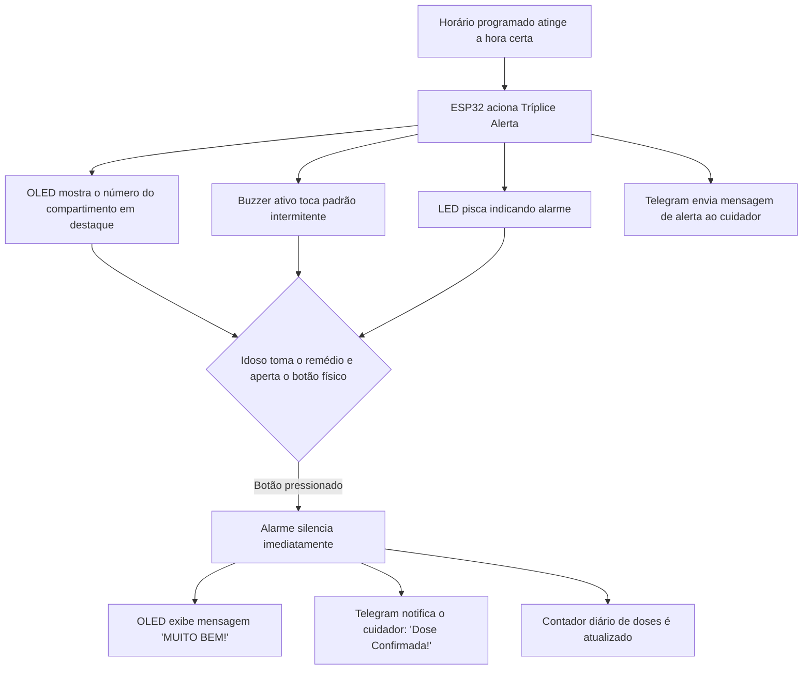

<div align="center">

# 💊 Pill Dispenser Inteligente
### Sistema Ciberfísico de Gestão e Monitoramento de Medicação para Idosos

[](https://www.espressif.com/)
[](https://www.arduino.cc/)
[](https://core.telegram.org/bots)
[](#)
[](#)

<p align="center">
  <b>Dispenser inteligente com tríplice alerta (Display OLED, Som e Luz), confirmação física de dose, sincronização automática de horário via NTP, dashboard web local e notificações em tempo real ao cuidador via Telegram.</b>
</p>

*Projeto acadêmico desenvolvido para a disciplina de Conectividade de Sistemas Ciberfísicos • Engenharia de Software*

---

</div>

## 📌 Sumário
- [📖 Sobre o Projeto](#-sobre-o-projeto)
- [✨ Principais Recursos](#-principais-recursos)
- [🔄 Fluxo de Funcionamento](#-fluxo-de-funcionamento)
- [🛠️ Especificações de Hardware e Pinagem](#️-especificações-de-hardware-e-pinagem)
- [📲 Integração com o Telegram](#-integração-com-o-telegram)
- [🌐 Dashboard Web Local](#-dashboard-web-local)
- [📦 Bibliotecas e Dependências](#-bibliotecas-e-dependências)
- [🚀 Instalação e Configuração](#-instalação-e-configuração)
- [📁 Estrutura do Repositório](#-estrutura-do-repositório)
- [👥 Equipe e Autores](#-equipe-e-autores)

---

## 📖 Sobre o Projeto

Idosos que moram sozinhos ou passam grande parte do dia desacompanhados enfrentam dificuldades rotineiras na gestão de sua terapia medicamentosa. Esquecimentos, confusão de horários e equívocos na identificação de comprimidos em tratamentos com múltiplas doses diárias (café da manhã, almoço, tarde, jantar e noite) são fatores críticos de internações e agravamento de doenças crônicas.

O **Pill Dispenser Inteligente** conecta o ambiente físico ao digital para garantir a adesão ao tratamento e proporcionar tranquilidade a familiares e cuidadores:

1. **Guia Visual Direto:** Ao tocar o alarme, o visor OLED exibe em números gigantescos o **número exato do compartimento/potinho** que deve ser aberto.
2. **Estímulo Multissensorial:** Alarme sonoro pulsante e LED de alto brilho garantem que idosos com leve deficiência auditiva ou visual percebam o alerta.
3. **Comprovação de Tomada da Dose:** O idoso aperta o botão de confirmação após retirar a medicação, silenciando o sistema.
4. **Alerta Imediato ao Cuidador:** O ESP32 envia uma notificação instantânea via **Telegram** para o celular do responsável, informando o número do potinho e a hora exata da ingestão.

---

## ✨ Principais Recursos

- ⏰ **Sincronização Automática via NTP:** Obtém o horário oficial de Brasília (UTC-3) pela internet via servidores `pool.ntp.org`, dispensando ajustes manuais de relógio.
- 💾 **Persistência em Memória Flash (NVS):** Todos os alarmes e associações com compartimentos são salvos via `Preferences.h`, mantendo-se intactos mesmo se a energia cair.
- 📱 **Controle Bidirecional por Telegram:** Permite ao cuidador consultar status, cadastrar ou remover alarmes, receber confirmações e até acionar ou confirmar alarmes remotamente por botões interativos (*inline keyboards*).
- 🌐 **Dashboard Web Embarcado:** Interface gráfica moderna hospedada no próprio microcontrolador (Porta 80) para configuração rápida via navegador em qualquer celular, tablet ou computador conectado à mesma rede.
- 🔘 **Debounce Instantâneo:** Leitura do botão via resistor pull-up interno (`INPUT_PULLUP`) com tratamento rápido contra repique mecânico (*debounce*).
- 🎨 **Animações Gráficas no Display OLED:** Animação de inicialização com ilustração de cápsula/onda cardíaca e barra de carregamento fluida.

---

## 🔄 Fluxo de Funcionamento



---

## 🛠️ Especificações de Hardware e Pinagem

### Componentes Utilizados

| Componente | Função no Sistema | Detalhes Técnicos |
|---|---|---|
| **ESP32 Dev Module** | Microcontrolador central | Wi-Fi 2.4 GHz, 30 pinos |
| **Display OLED 0.96"** | Interface visual local para o idoso | Resolução 128x64, Barramento I2C (SSD1306) |
| **Buzzer Ativo 5V / 3.3V** | Sinalizador sonoro de alta frequência | Controle digital liga/desliga |
| **LED Difuso (5mm)** | Sinalizador visual de bancada | Limitado com resistor de 220Ω / 330Ω |
| **Pushbutton Táctil** | Botão de confirmação de dose tomada | Ligado em pull-up interno para o GND |
| **Organizador de Comprimidos** | Armazenamento físico das doses | Caixinhas numeradas (1 a 20) |
| **Fonte / Cabo Micro-USB** | Alimentação do circuito | 5V / 1A - 2A |

### Diagrama de Pinagem (ESP32)

```
                       +-------------------+
                       |    ESP32 DevKit   |
                       |                   |
        [OLED SCL] --->| GPIO 22           |
        [OLED SDA] --->| GPIO 21           |
        [BUZZER +] --->| GPIO 18           |
        [LED +]    --->| GPIO 4            |
        [BOTÃO]    --->| GPIO 13 (PULLUP)  |---> [BOTÃO OUTRO TERMINAL] ---> GND
        [VCC 3.3V] --->| 3V3 / VIN         |
        [GND]      --->| GND               |
                       +-------------------+
```

> [!NOTE]
> O botão físico está configurado com `pinMode(PINO_BOTAO, INPUT_PULLUP)`. Um terminal conecta-se ao **GPIO 13** e o outro terminal diretamente ao **GND**, eliminando a necessidade de resistores externos na protoboard.

---

## 📲 Integração com o Telegram

O robô envia notificações proativas sempre que um alarme dispara ou quando uma dose é ingerida. Além disso, o cuidador pode interagir através dos comandos:

| Comando | Descrição | Exemplo de Uso |
|---|---|---|
| `/status` | Exibe hora atual, próximo alarme, doses tomadas hoje e estado do LED | `/status` |
| `/alarmes` ou `/listar` | Lista todas as doses do dia com os respectivos compartimentos | `/alarmes` |
| `/add <hh:mm> <pote>` | Adiciona um novo horário e associa ao número do pote (1 a 20) | `/add 08:30 1` |
| `/horarios <h:m p, ...>` | Cadastra uma rotina completa de horários de uma só vez | `/horarios 08:00 1, 12:30 2, 20:00 3` |
| `/confirmar` | Confirma o alarme remotamente pelo Telegram caso necessário | `/confirmar` |
| `/disparar <pote>` | Dispara um teste de alarme imediatamente para simulação | `/disparar 2` |
| `/limpar` | Apaga todos os alarmes salvos na memória Flash | `/limpar` |
| `/ajuda` | Mostra o menu de ajuda com todos os comandos disponíveis | `/ajuda` |

---

## 🌐 Dashboard Web Local

O ESP32 executa um servidor HTTP próprio na porta `80`. Ao conectar qualquer dispositivo (smartphone, notebook) na mesma rede Wi-Fi, basta abrir o navegador no endereço IP do ESP32 (`http://<IP_DO_ESP32>/`) para acessar uma interface web completa:

- **Monitoramento em Tempo Real:** Visualização do relógio sincronizado, doses do dia e alertas em andamento.
- **Painel de Controle:** Botões para disparar alarme de teste, silenciar alarme ativo e ligar/desligar a luz de bancada.
- **Gestão de Horários:** Formulário para inclusão e exclusão dinâmica de alarmes sem necessidade de reconectar o microcontrolador ao computador.

---

## 📦 Bibliotecas e Dependências

Instale as seguintes bibliotecas através do **Library Manager** da Arduino IDE (`Ctrl + Shift + I`):

1. **Adafruit SSD1306** (por Adafruit) — *Instale todas as dependências adicionais solicitadas, como a `Adafruit GFX`*.
2. **UniversalTelegramBot** (por Brian Lough).
3. **ArduinoJson** (por Benoît Blanchon) — *Versão 6.x ou 7.x*.

Bibliotecas nativas do ESP32 Core já inclusas no pacote da placa:
- `WiFi.h`
- `WiFiClientSecure.h`
- `WebServer.h`
- `Wire.h`
- `Preferences.h`
- `time.h`

---

## 🚀 Instalação e Configuração

### 1. Clonar o Repositório
```bash
git clone https://github.com/seu-usuario/PillDispenser.git
cd PillDispenser
```

### 2. Abrir o Código na Arduino IDE
Abra o arquivo principal localizado em:
```
pill_dispenser/pill_dispenser.ino
```

### 3. Configurar Credenciais
No início do arquivo `pill_dispenser.ino`, atualize as seguintes constantes com suas informações:

```cpp
// Credenciais do Telegram (obtidas com o @BotFather e @userinfobot)
#define BOT_TOKEN "SEU_BOT_TOKEN_AQUI"
#define CHAT_ID   "SEU_CHAT_ID_AQUI"

// Rede Wi-Fi
const char* WIFI_SSID = "NOME_DA_SUA_REDE_WIFI"; 
const char* WIFI_PASS = "SENHA_DO_SEU_WIFI";
```

### 4. Gravação no ESP32
1. Conecte o ESP32 ao computador via cabo USB de dados.
2. Na Arduino IDE, selecione a placa **ESP32 Dev Module** (em *Ferramentas -> Placa -> ESP32 Arduino*).
3. Selecione a porta COM correspondente.
4. Clique em **Carregar (Upload)**.
5. Abra o **Monitor Serial** configurado em `115200 baud` para visualizar a inicialização, a conexão Wi-Fi e o IP atribuído ao servidor web.

---

## 📁 Estrutura do Repositório

```text
PillDispenser/
│
├── pill_dispenser/
│   └── pill_dispenser.ino   # Código-fonte oficial completo para o ESP32
│
└── README.md                # Documentação técnica e guia do projeto
```

> [!TIP]
> A pasta e o arquivo de código possuem o mesmo nome (`pill_dispenser/pill_dispenser.ino`), atendendo integralmente ao padrão exigido pela Arduino IDE para abertura direta sem avisos de realocação.

---

## 👥 Equipe e Autores

Projeto desenvolvido com dedicação por:

- **Henrique Gnatkovski**
- **Julia Moura**
- **Letícia Prata**
- **Sabrina Bernardi**
- **Yasmin Luz**

*Curso de Engenharia de Software • Disciplina de Conectividade de Sistemas Ciberfísicos*
