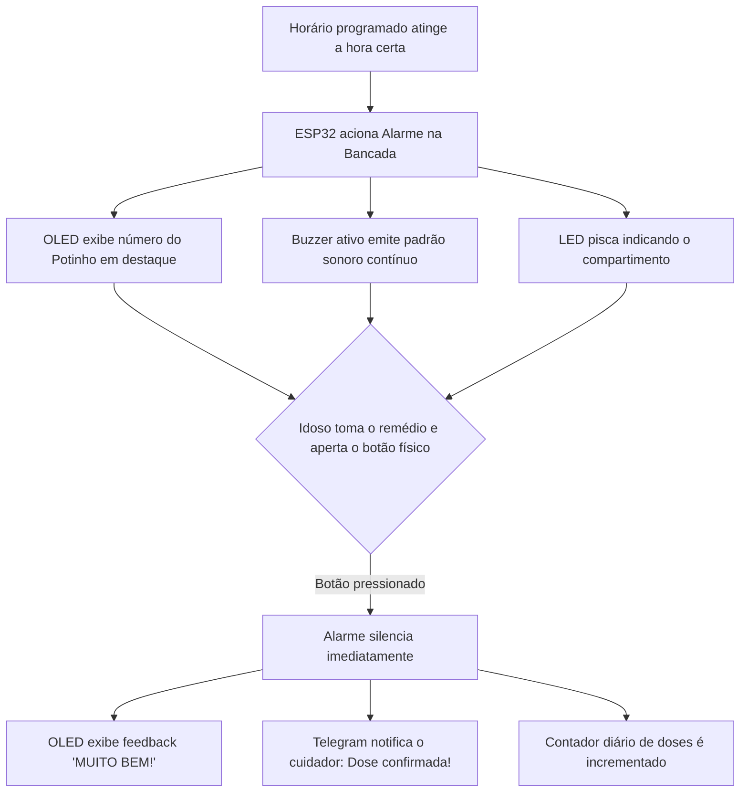

<div align="center">

# 💊 Pill Dispenser Inteligente
### Sistema Ciberfísico de Gestão e Monitoramento de Medicação para Idosos

[](https://www.espressif.com/)
[](https://www.arduino.cc/)
[](https://core.telegram.org/bots)
[](#)
[](#)

<p align="center">
  <b>Dispensador inteligente com tríplice alerta sensorial (Display OLED SSD1306, Buzzer e LED), confirmação física via botão com debounce, relógio em tempo real sincronizado via NTP, dashboard web responsivo para o cuidador e notificações instantâneas no Telegram.</b>
</p>

*Projeto acadêmico desenvolvido para a disciplina de Conectividade de Sistemas Ciberfísicos • Bacharelado em Engenharia de Software • PUCPR*

---

</div>

## 📌 Sumário
- [📖 Sobre o Projeto](#-sobre-o-projeto)
- [✨ Principais Recursos](#-principais-recursos)
- [🔄 Fluxo de Funcionamento](#-fluxo-de-funcionamento)
- [🛠️ Especificações de Hardware e Pinagem](#️-especificações-de-hardware-e-pinagem)
- [📲 Notificações e Comandos via Telegram](#-notificações-e-comandos-via-telegram)
- [🌐 Dashboard Web do Cuidador](#-dashboard-web-do-cuidador)
- [📦 Bibliotecas e Dependências](#-bibliotecas-e-dependências)
- [🚀 Instalação e Configuração](#-instalação-e-configuração)
- [📁 Estrutura do Repositório](#-estrutura-do-repositório)
- [👥 Equipe e Autores](#-equipe-e-autores)

---

## 📖 Sobre o Projeto

Idosos que residem sozinhos ou passam períodos do dia sem acompanhamento presencial enfrentam desafios diários na gestão de seus medicamentos. Esquecimentos, confusão entre caixas semelhantes e atrasos em tratamentos poli-medicamentosos representam riscos clínicos graves e internações evitáveis.

O **Pill Dispenser Inteligente** conecta o ambiente físico ao digital para garantir a adesão terapêutica e dar total tranquilidade aos familiares e cuidadores:

1. **Identificação Visual Clara:** Ao soar o alarme, o display OLED exibe de forma destacada o **número do compartimento/potinho (1 a 20)** a ser retirado.
2. **Estímulo Multissensorial:** A combinação de buzzer contínuo e LED difuso garante que o paciente perceba o chamado, mesmo em outro cômodo ou com leve limitação sensorial.
3. **Confirmação Física pelo Idoso:** O paciente retira o comprimido da gaveta correspondente e aperta o botão frontal, silenciando o alarme.
4. **Comunicação Direta com o Cuidador:** O ESP32 despacha na hora uma notificação silenciosa e limpa no Telegram do cuidador com o pote ingerido e o horário exato.

---

## ✨ Principais Recursos

- ⏰ **Sincronização Automática via NTP:** Obtém o horário oficial de Brasília (UTC-3) pela internet via servidores `pool.ntp.org`, dispensando ajustes manuais de relógio ou RTC externo.
- 💾 **Persistência em Memória Não-Volátil (NVS):** Todos os alarmes e associações com compartimentos são gravados com a biblioteca `Preferences.h`, permanecendo salvos mesmo após quedas de energia.
- 📱 **Integração com Telegram Bot:** Notificação automática no smartphone do cuidador e comandos remotos com filtro rígido de segurança por `CHAT_ID`.
- 🌐 **Dashboard Web Embarcado:** Interface web moderna e responsiva (porta 80) com UX humanizada para cuidadores: atalhos rápidos (*Manhã, Almoço, Tarde, Noite*), seletor de potes e modo desenvolvedor protegido.
- 🔘 **Debounce Instantâneo:** Leitura do pushbutton com pull-up interno (`INPUT_PULLUP`) e filtro mecânico para evitar falsos acionamentos.
- 🔒 **Privacidade de Dados:** Bloqueio de comandos de usuários desconhecidos no Telegram; apenas o cuidador autorizado gerencia o sistema.

---

## 🔄 Fluxo de Funcionamento



---

## 🛠️ Especificações de Hardware e Pinagem

### Componentes Utilizados

| Componente | Função no Sistema | Detalhes Técnicos |
|---|---|---|
| **ESP32 Dev Module** | Microcontrolador central com conectividade Wi-Fi | 30 pinos, 2.4 GHz 802.11 b/g/n |
| **Display OLED 0.96"** | Interface visual de mensagens ao paciente | Resolução 128x64, I2C SSD1306 |
| **Buzzer Ativo** | Emissor sonoro de advertência de dose | 5V / 3.3V, controle digital ON/OFF |
| **LED Difuso (5mm)** | Sinalizador luminoso do compartimento | Resistor de proteção 220Ω / 330Ω |
| **Pushbutton Táctil** | Botão de confirmação de ingestão | Ligação pull-up interna para GND |
| **Organizador de Comprimidos** | Armazenamento físico numerado | Caixinhas / potinhos (1 a 20) |
| **Alimentação** | Cabo Micro-USB conectado à fonte 5V | 5V / 1A - 2A |

### Diagrama de Pinagem

```text
                       +-------------------+
                       |    ESP32 DevKit   |
                       |                   |
        [OLED SCL] --->| GPIO 22           |
        [OLED SDA] --->| GPIO 21           |
        [BUZZER +] --->| GPIO 18           |
        [LED +]    --->| GPIO 4            |
        [BOTÃO]    --->| GPIO 13 (PULLUP)  |---> [OUTRO TERMINAL DO BOTÃO] ---> GND
        [VCC 3.3V] --->| 3V3               |
        [GND]      --->| GND               |
                       +-------------------+
```

> [!NOTE]
> O botão físico utiliza `pinMode(PINO_BOTAO, INPUT_PULLUP)`. Um terminal conecta-se ao **GPIO 13** e o outro diretamente ao **GND**, dispensando resistores externos na protoboard.

---

## 📲 Notificações e Comandos via Telegram

O bot `@pill_disp_bot` opera com foco em privacidade e objetividade, enviando notificações proativas nas situações cruciais e disponibilizando comandos remotos.

### Mensagens Automáticas (Sem excesso de alertas)

1. **Ao Ligar o Dispositivo (Boot):**
   ```text
   Pill Dispenser iniciado!
   Status: Online
   ```

2. **Ao Confirmar a Ingestão do Medicamento:**
   ```text
   Dose confirmada!
   Pote 2 • 19:15
   ```

### Comandos Registrados no BotFather

| Comando | Descrição | Exemplo de Uso |
|---|---|---|
| `/status` | Exibe se o aparelho está online, próximo remédio e doses do dia | `/status` |
| `/alarmes` | Lista os horários agendados e os potes associados | `/alarmes` |
| `/confirmar` | Registra a confirmação da dose pelo celular | `/confirmar` |
| `/adicionar` | Adiciona um horário individual e o número do pote | `/adicionar 08:00 1` |
| `/horarios` | Cadastra a rotina completa do dia em lote | `/horarios 08:00 1, 12:30 2, 20:00 3` |

> [!TIP]
> O comando de bancada `/disparar <pote>` (ex: `/disparar 2`) permanece disponível para testes do alarme físico, mas não é exposto no menu público para evitar acionamentos acidentais.

---

## 🌐 Dashboard Web do Cuidador

O ESP32 hospeda um Web Server autônomo na porta `80`. Ao acessar o endereço IP do dispositivo via navegador (`http://<IP_DO_ESP32>/`), o cuidador encontra uma interface limpa e intuitiva:

- **Identificação do Paciente e Relógio:** Visualização clara do paciente assistido e hora sincronizada.
- **Banner de Status Inteligente:** Card dinâmico que permanece verde (*"Tudo em ordem"*) em repouso e assume animação pulsante em alerta (*"HORA DO REMÉDIO!"*), orientando qual pote entregar.
- **Cadastro Simples em 3 Etapas:**
  1. Digitação do nome comercial do medicamento (*ex: Losartana 50mg*).
  2. Seleção de horário por atalhos de 1 clique (*☀️ Manhã 07:00, 🍽️ Almoço 12:00, ☕ Tarde 16:00, 🌙 Noite 20:00*) ou seletor manual.
  3. Mapeamento visual das gavetas/potinhos com avanço automático para o próximo compartimento livre.
- **Linha do Tempo de Medicamentos:** Relação dos remédios do dia em ordem cronológica com botão de exclusão rápida.
- **Modo Desenvolvedor Colapsável:** Painel oculto com testes de buzzer e luz para bancada, preservando a interface do cuidador limpa.

---

## 📦 Bibliotecas e Dependências

Instale as seguintes bibliotecas através do **Library Manager** da Arduino IDE (`Ctrl + Shift + I`):

1. **Adafruit SSD1306** (por Adafruit) — *Com sua dependência `Adafruit GFX Library`*.
2. **UniversalTelegramBot** (por Brian Lough).
3. **ArduinoJson** (por Benoît Blanchon) — *Versão 6.x ou 7.x*.

Bibliotecas nativas do core ESP32 (já inclusas na instalação da placa):
- `WiFi.h` e `WiFiClientSecure.h`
- `WebServer.h`
- `Wire.h`
- `Preferences.h`
- `time.h`

---

## 🚀 Instalação e Configuração

### 1. Clonar o Repositório
```bash
git clone https://github.com/seu-usuario/PillDispenser.git
cd PillDispenser
```

### 2. Abrir o Código na Arduino IDE
Abra o projeto localizado na pasta:
```text
pill_dispenser/pill_dispenser.ino
```

### 3. Configurar Credenciais
No topo do arquivo, informe as credenciais de Wi-Fi e do Bot:

```cpp
// Credenciais do Telegram
#define BOT_TOKEN "SEU_BOT_TOKEN_AQUI"
#define CHAT_ID   "SEU_CHAT_ID_AQUI"

// Rede Wi-Fi
const char* WIFI_SSID = "NOME_DO_SEU_WIFI"; 
const char* WIFI_PASS = "SENHA_DO_SEU_WIFI";
```

### 4. Gravação no ESP32
1. Conecte o ESP32 ao computador via cabo USB.
2. Na Arduino IDE, selecione a placa **ESP32 Dev Module** e a porta serial (COM).
3. Clique em **Carregar (Upload)**.
4. Abra o **Monitor Serial** a `115200 baud` para acompanhar o status da conexão e verificar o IP da interface web.

---

## 📁 Estrutura do Repositório

```text
PillDispenser/
│
├── pill_dispenser/
│   └── pill_dispenser.ino   # Código-fonte oficial do ESP32 (preservado para upload)
│
└── README.md                # Documentação técnica completa e guia do projeto
```

---

## 👥 Equipe e Autores

Projeto desenvolvido para a disciplina de **Conectividade de Sistemas Ciberfísicos**:

- **Henrique Gnatkovski**
- **Julia Moura**
- **Letícia Prata**
- **Sabrina Bernardi**
- **Yasmin Luz**

*Pontifícia Universidade Católica do Paraná (PUCPR) • Escola Politécnica • Engenharia de Software*
